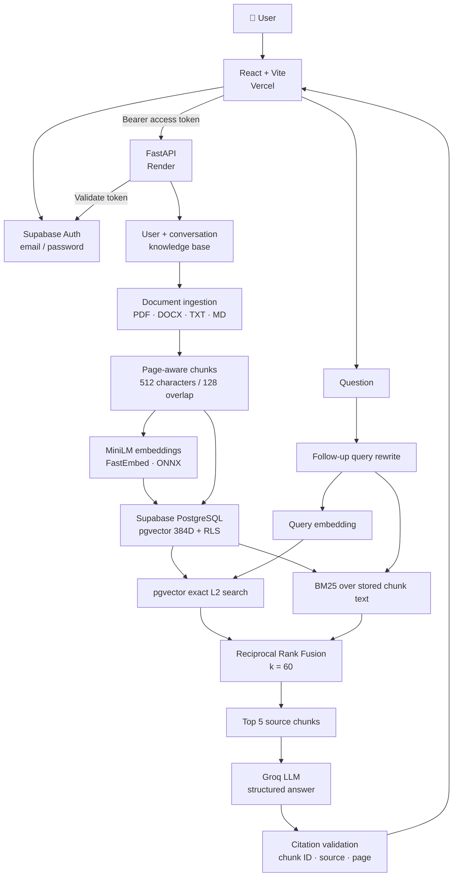

<p align="center">
  
</p>

<div align="center">

### Ask better questions. Find better evidence.

**A multi-document RAG workspace built for people who want answers from their files — not guesses.**

[](https://querylens-mu.vercel.app)
[](https://querylens-api-sczu.onrender.com/docs)
[](https://github.com/Raghavuchiha/querylens)


</div>

---

> **Integration status:** This branch implements Supabase pgvector for the web API. Database-level upload, retrieval, isolation and cascade deletion tests passed. Full authenticated application and restart tests are pending; the live deployment may still run the legacy FAISS backend. See [PGVECTOR_INTEGRATION.md](PGVECTOR_INTEGRATION.md).

## ✳️ The workspace, in action

<p align="center">
  
</p>

<p align="center"><sub>Actual QueryLens interface · React + Vite · retro editorial UI · screenshot from the live application</sub></p>

> **LESS SEARCHING. MORE UNDERSTANDING.**  
> Drop in a PDF, Word document, text file, or Markdown file. Ask a question. QueryLens retrieves relevant evidence, produces an answer, and links the answer to its source chunks.

### What makes QueryLens different?

| | Capability | What it does |
|:--:|---|---|
| 📂 | **Multi-document upload** | Index PDF, DOCX, TXT and MD files in the same conversation. |
| 🧠 | **Hybrid retrieval** | Combine persistent pgvector semantic search with BM25 keyword matching. |
| 🧮 | **Reciprocal Rank Fusion** | Merge both ranked retrieval lists instead of comparing incompatible raw scores. |
| 💬 | **Follow-up questions** | Rewrite conversational follow-ups into standalone search queries. |
| 🔖 | **Validated citations** | Match model-produced chunk IDs against actual retrieved chunks, with document/page snippets. |
| 🔐 | **Supabase login** | Email/password authentication with session management. |
| 🗂️ | **Conversation knowledge bases** | Persist documents and embeddings per verified user and conversation; enforce ownership with PostgreSQL row-level security. |
| 🪶 | **CPU-friendly embeddings** | Run MiniLM through ONNX-based FastEmbed instead of loading the full PyTorch stack. |

---

## 🏗️ System architecture



<details>
<summary><b>How hybrid retrieval actually works</b></summary>

### Semantic search → pgvector
Document chunks are embedded with `sentence-transformers/all-MiniLM-L6-v2` (384-dimensional vectors) using FastEmbed and stored with their metadata in Supabase PostgreSQL. The API calls `ql_match_chunks` for exact, conversation-scoped L2 retrieval and converts squared distance to `1 / (1 + distance)`. This score is not a probability or cosine similarity. The standalone legacy retrieval pipeline still supports FAISS.

### Keyword search → BM25
BM25 is rebuilt from persisted text in the selected conversation for each query and searches using token overlap, helping with exact terms such as `JWT`, `OAuth2`, product names, and identifiers.

### Fusion → RRF
QueryLens combines the ranked results:

```text
                    1
RRF(chunk) = Σ ─────────────
              60 + rank(chunk)
```

Each retrieval list contributes a rank-based score. The application takes the best fused chunks for answer generation.

### Grounding → Groq
The system prompt requests an answer from the retrieved text only. The model returns claims with chunk IDs; QueryLens checks these IDs against retrieved chunks and attaches the actual filename, page, and snippet. This validates the references, although it cannot guarantee every generated statement is factually correct.

</details>

---

## 🧭 How it works

```text
01  SIGN IN       Supabase email authentication
      ↓
02  START CHAT    A separate knowledge base per conversation
      ↓
03  UPLOAD        PDFs / DOCX / TXT / Markdown
      ↓
04  INDEX         MiniLM embeddings → Supabase pgvector
      ↓
05  ASK           Query rewrite → Hybrid search → RRF
      ↓
06  UNDERSTAND    Groq response + checked source citations
```

## 🔧 Tech stack

| Layer | Tools |
|---|---|
| Frontend | React 18, Vite, Lucide icons, CSS |
| Authentication | Supabase Auth + PostgreSQL RLS |
| API | Python, FastAPI, Pydantic, Uvicorn |
| Parsing | PyPDF, docx2txt, LangChain document loaders |
| Chunking | RecursiveCharacterTextSplitter |
| Embeddings | FastEmbed / ONNX · all-MiniLM-L6-v2 |
| Semantic retrieval | Supabase pgvector (exact L2); FAISS for standalone legacy retrieval |
| Lexical retrieval | BM25Okapi |
| Ranking | Reciprocal Rank Fusion |
| Generation | Groq API through LangChain ChatOpenAI |
| Deployment | Vercel frontend · Render backend |
| Persistent storage | Supabase PostgreSQL · documents, document_chunks, conversations |

---

## 🗃️ Repository map

```text
querylens/
├── frontend/
│   ├── src/
│   │   ├── App.jsx          # workspace & conversations
│   │   ├── Auth.jsx         # signup / sign-in
│   │   ├── api.js           # authenticated API requests
│   │   ├── supabase.js      # Supabase client
│   │   └── styles.css      # editorial UI
│   ├── vite.config.js       # local API proxy
│   └── vercel.json         # SPA routing
├── src/
│   ├── api.py               # protected FastAPI endpoints
│   ├── ingestion.py         # file loading & chunking
│   ├── loaders.py           # supported file loaders
│   ├── vectorstore.py       # MiniLM + legacy FAISS + BM25 + RRF
│   ├── pgvector_store.py    # authenticated persistent retrieval adapter
│   ├── query_rewrite.py     # conversational search query
│   ├── synthesis.py         # Groq answers + citation checks
│   ├── llm.py               # Groq model configuration
│   └── models.py            # Pydantic schemas
├── assets/
│   ├── querylens-banner.svg
│   └── querylens-workspace.jpg
├── requirements.txt
├── render.yaml
├── PGVECTOR_INTEGRATION.md
└── DEPLOYMENT.md
```

---

## ⚡ Run locally

**Requirements:** Python 3.11+, Node.js and npm, a Supabase project, and a Groq API key.

```bash
git clone https://github.com/Raghavuchiha/querylens.git
cd querylens
git switch pgvector-integration
python -m venv .venv
```

Activate the environment:

```powershell
# Windows PowerShell
.venv\Scripts\Activate.ps1
```

```bash
# macOS / Linux
source .venv/bin/activate
```

Install Python dependencies from the repository root:

```bash
pip install -r requirements.txt
```

### Backend environment

Copy `src/.env.example` to `src/.env` and fill in:

```env
SUPABASE_URL=https://YOUR_PROJECT.supabase.co
SUPABASE_PUBLISHABLE_KEY=sb_publishable_your_key
GROQ_API_KEY=your_groq_key
GROQ_MODEL=openai/gpt-oss-120b
```

### Frontend environment

Copy `frontend/.env.example` to `frontend/.env`:

```env
VITE_SUPABASE_URL=https://YOUR_PROJECT.supabase.co
VITE_SUPABASE_PUBLISHABLE_KEY=sb_publishable_your_key
VITE_API_URL=/api
```

The database must have the existing `conversations`, `documents` and `document_chunks` tables, `vector(384)`, ownership policies and the `ql_save_upload` and `ql_match_chunks` RPCs. See [PGVECTOR_INTEGRATION.md](PGVECTOR_INTEGRATION.md). The API forwards the user's bearer token with the publishable key; no service-role key is required.

In the Supabase dashboard, enable **Authentication → Email**, and configure the local redirect URL under **Authentication → URL Configuration**.

Launch the backend:

```bash
cd src
python -m uvicorn api:app --reload --port 8000
```

Launch the frontend in a second terminal:

```bash
cd frontend
npm install
npm run dev
```

On Windows with PowerShell script restrictions, use `npm.cmd install` and `npm.cmd run dev`. Open **http://localhost:5173**.

> Environment secrets belong in local `.env` files and hosting dashboards — never commit them to Git.

---

## 🔌 API at a glance

All document/query routes require a valid **Supabase access token** as `Authorization: Bearer <token>`. FastAPI verifies the token with Supabase before accessing a user’s documents.

| Method | Endpoint | Purpose |
|:--|:--|:--|
| `GET` | `/health` | Lightweight health check |
| `POST` | `/upload` | Upload and index documents for a conversation |
| `POST` | `/query` | Ask a question and receive an answer with citations |
| `GET` | `/documents?conversation_id=...` | List documents in a conversation |
| `DELETE` | `/documents/{doc_id}?conversation_id=...` | Delete a document and cascade-delete associated chunks |
| `GET` | `/evaluation/metrics` | Read a local evaluation results file, if present |

**Query example**

```json
{
  "query": "What are the key findings?",
  "conversation_id": "your-conversation-uuid"
}
```

**Answer shape**

```json
{
  "answer": "An answer based on the retrieved passages...",
  "citations": [
    {
      "chunk_id": "retrieved-chunk-id",
      "claim": "A factual claim...",
      "doc_name": "report.pdf",
      "page": 3,
      "snippet": "The relevant source passage..."
    }
  ]
}
```

---

## ☁️ Live deployment

| Service | Role | Link |
|---|---|---|
| **Vercel** | React frontend | [Open QueryLens](https://querylens-mu.vercel.app) |
| **Render** | FastAPI backend | [API docs](https://querylens-api-sczu.onrender.com/docs) |
| **Supabase** | Email/password auth and persistent pgvector (integration branch) | [Supabase](https://supabase.com) |
| **Groq** | Language model inference | [Groq Cloud](https://console.groq.com) |

The frontend's deployed `VITE_API_URL` must be the **full Render URL**. Render's `CORS_ORIGINS` must exactly match the Vercel origin, without a trailing slash. Read [DEPLOYMENT.md](DEPLOYMENT.md) for deployment instructions.

### ⚠️ Current limitations and roadmap

This is a **portfolio/demo implementation**, not a fully production-hardened document service.

- **Migration and rollout:** pgvector persistence is implemented on this branch and database-level tests passed. Legacy local JSON documents are not migrated automatically; back them up and re-upload or migrate before switching the live backend.
- **Retrieval scaling:** Exact vector search and per-query BM25 reconstruction are intended for modest conversation sizes; approximate indexing and keyword caching remain future improvements.
- **Backend chat memory:** Follow-up history is process-local and resets on backend restart.
- **Browser-local chats:** The React conversation history lives in localStorage, scoped by user ID on the same browser, not synchronized across devices.
- **Server-side Groq key:** The backend currently uses an environment API key. Per-user BYOK support is planned, not implemented.
- **Limits:** Public multi-user rate limiting and upload quotas beyond the per-file size cap need further work.
- **Testing:** Database-level vector insertion, retrieval, cross-user isolation and deletion passed. Authenticated end-to-end upload, citations, deletion and restart testing remain pending.

### Next steps

- [x] Implement persistent **Supabase pgvector** storage on the integration branch
- [ ] Verify authenticated end-to-end behavior and restart persistence, then deploy
- [ ] Add **per-user Groq API key (BYOK)** configuration
- [ ] Add persistent conversation history
- [ ] Improve upload telemetry, error messages and request limits

---

<div align="center">

### BUILT TO MAKE INFORMATION USEFUL.

**Designed & developed by [Raghav Mandloi](https://github.com/Raghavuchiha)**

[Launch QueryLens](https://querylens-mu.vercel.app) · [Explore the code](https://github.com/Raghavuchiha/querylens) · [Report an issue](https://github.com/Raghavuchiha/querylens/issues)

<sub>Less noise. More signal. ✳</sub>

</div>
